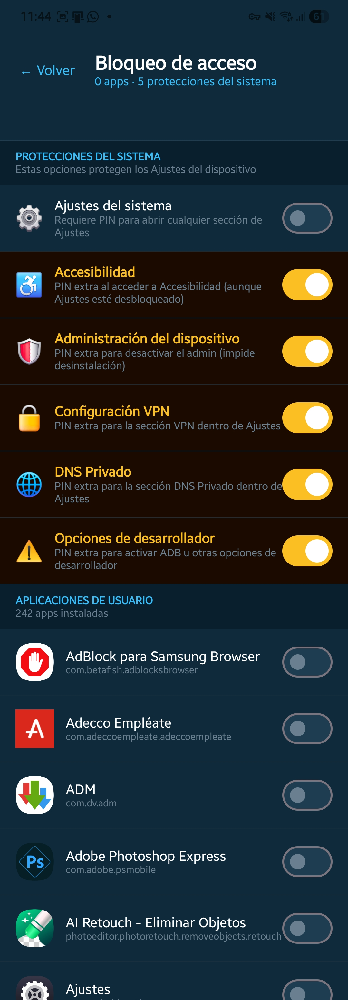

> Publicado originalmente en [adeodato.es](https://adeodato.es/articulo-adeoshield.html).

Filtrar lo que ve un Android **sin rootearlo y sin ADB** parece imposible: el sistema aísla las apps entre sí. La clave no es pelearse con Android, sino usar sus propias piezas —**VpnService** y **servicio de Accesibilidad**— para montar una defensa en capas. Así construí **AdeoShield**: nació para proteger a una familia de verdad, y es también un ejercicio de ingeniería de seguridad.

## Qué hace, en resumen

AdeoShield (nativo en Kotlin + Jetpack Compose) no es solo un filtro de webs. Combina cuatro capacidades:

- **Filtrado de red por DNS-over-HTTPS** contra **AdGuard Family DNS** (bloquea contenido adulto y malicioso a nivel de resolución de nombres).
- **Bloqueo de los ajustes sensibles** del sistema que permitirían desactivar la protección.
- **Bloqueo de aplicaciones por PIN:** el adulto elige qué apps proteger y AdeoShield exige el PIN para abrirlas.
- **Protección por PIN** de toda la configuración, con criptografía seria.

## Cómo funciona: defensa en tres capas

**1. Capa de resolución.** Un `VpnService` local captura las consultas DNS del dispositivo y las reenvía cifradas (DoH) a AdGuard Family DNS. No hay servidor propio ni túnel a terceros: el contenido no deseado *ni siquiera llega a resolverse*. El esqueleto del túnel es el patrón estándar de Android:

```kotlin
val builder = Builder()
    .setSession("AdeoShield")
    .addAddress("10.0.0.2", 32)
    .addDnsServer("10.0.0.1")   // el DNS lo atiende la propia app
val vpnInterface = builder.establish()
// Leer las consultas DNS del descriptor, resolverlas por DoH y filtrar.
```

**2. Capa de persistencia.** Un `AccessibilityService` vigila las pantallas que apagarían la protección —Accesibilidad, VPN, DNS privado, administradores de dispositivo, opciones de desarrollador— y las bloquea o las protege con PIN. Sin esta capa, el filtro se desactivaría en dos toques.

**3. Capa de autenticación.** El PIN protege toda la configuración: derivado con `PBKDF2WithHmacSHA256`, **120.000 iteraciones** y *salt* aleatorio por instalación. Nunca se guarda en claro, y hay bloqueo temporal tras varios intentos fallidos.

## Más que webs: bloqueo de aplicaciones por PIN

La parte que más suele sorprender: además de filtrar dominios, AdeoShield deja al adulto **seleccionar apps concretas** de la lista de instaladas. Cuando alguien intenta abrir una app bloqueada, el servicio de Accesibilidad **intercepta la apertura y pide el PIN** antes de dejar entrar. El control no es solo de red, también de acceso a aplicaciones — todo bajo la misma autenticación.



## Protecciones configurables y el punto ciego del DNS privado

- **Granularidad:** cinco protecciones activas por defecto; el bloqueo de "Ajustes del sistema" se ofrece como opción avanzada *desactivada* por defecto, por su impacto en la usabilidad.
- **Detección de DNS privado (DoT):** si el usuario configura un DNS privado a nivel de sistema, este podría resolver consultas *antes* de que entren en el túnel. AdeoShield detecta esa situación y avisa — un vector de elusión que muchas soluciones ignoran.

## El modelo de amenaza (y sus límites honestos)

Parte de la ingeniería seria es decir **hasta dónde NO llega** la defensa:

- **Restricted Settings (Android 13+):** el sistema bloquea conceder Accesibilidad a apps instaladas por *sideload* (APK), lo que afecta a la capa de bloqueo de ajustes en dispositivos modernos. En Android 10 no ocurre. Documentado en el modelo de amenazas.
- **DNS privado del sistema (DoT):** puede resolver antes del túnel; la app avisa, pero la mitigación total depende de proteger esa pantalla.
- **Acceso físico:** modo seguro o restablecimiento de fábrica sortean cualquier control parental de app.

La premisa es honesta: en un dispositivo que el usuario controla físicamente, ninguna protección a nivel de app es absoluta. El objetivo es **elevar mucho el coste y la dificultad** de eludirla, no prometer lo imposible. Probado en dispositivos reales (Galaxy J6 con Android 10 y A54 con Android 13+), con APK de release firmado.

## Por qué open source (GPL-3.0)

AdeoShield es libre bajo **GPL-3.0**: cualquier derivado debe seguir siendo libre. En una herramienta de protección familiar, que el código sea auditable importa — nadie tiene que fiarse de mi palabra, puede leerlo.

## La lección

Incluso un "simple" control parental es un ejercicio de ingeniería de seguridad: entender el modelo de la plataforma, usar sus piezas a tu favor, cifrar por defecto, defender en profundidad, proteger la propia app y ser transparente sobre sus límites. Pensar como atacante para construir mejor como desarrollador.

---

*Escrito por Rafael Adiosdado Caballero Diéguez — **Adeodato**, ciberseguridad IT/OT y desarrollo Android seguro. Más en [adeodato.es](https://adeodato.es) · [AdeoShield en GitHub](https://github.com/Adeodato-hub/AdeoShield).*
